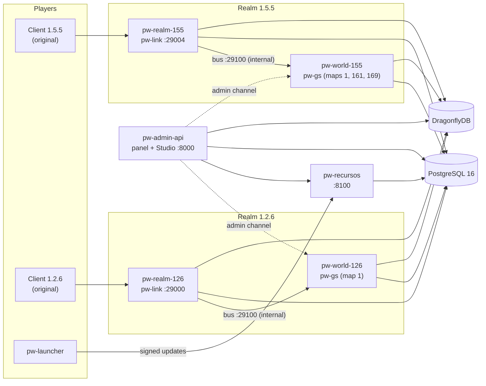

<div align="center">

# pw-universal-server

**A from-scratch Rust reimplementation of the Perfect World MMO server<br>that runs the original, unmodified game client — several game versions on one account base.**

[](LICENSE)


[](https://github.com/mur1ll0/pw-universal-server/stargazers)

[Downloads](#-downloads) ·
[Features](#-what-it-does-today) ·
[Quick start](#-quick-start) ·
[Status & roadmap](#-status--roadmap) ·
[Contributing](#-contributing)

</div>

---

> ⭐ **If you like this project, please give it a star.** It is the simplest way to tell us the work is worth
> continuing, and it helps other Perfect World fans and preservationists find it.

## Table of contents

- [Why this project exists](#-why-this-project-exists)
- [What makes it different](#-what-makes-it-different)
- [Downloads](#-downloads) — the **launcher** and the **Blender extension**
- [What it does today](#-what-it-does-today)
- [Architecture](#-architecture)
- [Requirements](#-requirements)
- [Quick start](#-quick-start)
- [Running the tests](#-running-the-tests)
- [Status & roadmap](#-status--roadmap)
- [Repository layout](#-repository-layout)
- [Documentation](#-documentation)
- [Contributing](#-contributing)
- [Legal notice](#-legal-notice)
- [License](#-license)

---

## 🎯 Why this project exists

Every Perfect World private server today runs on the same thing: **leaked, closed, 32-bit Linux binaries** from more
than a decade ago (`gs`, `glinkd`, `gdeliveryd`, `gamedbd`…). Nobody can fix them, extend them or even run two game
versions side by side. Editing game content means a collection of unrelated third-party editors, manual file copying
and hand-made client patches. When something breaks, there is no source to read.

**pw-universal-server replaces that stack with open, modern, documented code** — while keeping the one thing players
care about untouched: **the original game client**. No patched `.exe`, no injected DLL for the protocol; the client
connects to our server exactly as it connected to the official one.

On top of the server, the project ships the **tooling a server needs to live**: an admin web panel, a game-data
studio, a signed client-update service, a native launcher and a Blender extension for 3D models.

## ✨ What makes it different

| | |
| :--- | :--- |
| 🎮 **Original client, unmodified** | The protocol is reproduced byte by byte per client version. A server-to-client packet with the wrong size is silently dropped by the client, so every encoder is checked against the protocol IR, the client headers and the client binary itself. |
| 🧬 **One server, many versions** | The game rules live once, in `pw-gs`. What changes between versions is only the **wire layout** (`crates/pw-protocol/src/versions/`) and the **data of the realm** (`data/<realm>/config`). One PostgreSQL account base, one realm per game version — today **1.5.5** and **1.2.6**. |
| 🔬 **Evidence, never guesses** | Every layout, number, unit and rule is ported from the original C++ source of the server and client, measured on the client binary, taken from packet captures of an original 1.2.6 server, or read from the data file itself — and the code **cites file and line**. Data files are parsed by the client's own loader rules and must end exactly at their last byte. |
| 🦀 **Modern stack** | Rust + Tokio, PostgreSQL 16, DragonflyDB, Docker Compose. 900+ automated tests, run against a real database in an isolated `test` schema. |
| 🛠️ **Complete toolchain** | Web admin panel, a player self-service panel, a game-data **Studio** with draft → publish → revert versioning, a signed **client updater**, a native **launcher** (Windows 7 → 11) and a **Blender extension** for model round-trips. |
| 📚 **Living specifications** | `specs/` describes how the system *is*, area by area, and is updated in the same change as the code. Every decision has its evidence recorded in the session history. |

## 📦 Downloads

The two end-user deliverables are published on the
**[Releases page](https://github.com/mur1ll0/pw-universal-server/releases)**.

### 🚀 pw-launcher — install, update, repair and play

<sub>`tools/pw-launcher` · release tag `launcher-v*` · `pw-launcher-x64.exe` / `pw-launcher-x86.exe`</sub>

A single native Win32 executable — **no installer, no WebView, no runtime** — that runs on **Windows 7, 8, 10 and 11**.

- **Download the game** from the server's update service, resuming interrupted downloads (HTTP `Range`), or
  **adopt an existing installation** and repair only what differs.
- **Updates** download only new or changed files; **Verify files** (quick or full SHA-256) and **Repair**.
- Every manifest is **signed with Ed25519** and checked against the public key built into the launcher.
- One folder per game version, chosen from a drop-down; **Play** starts the client with the right arguments.
- Points the client's `serverlist.txt` and `currentserver.ini` at the server automatically — changing the server IP
  only requires changing the update-server address in the launcher.
- **Game options** window (window/fullscreen, resolution, widescreen, quality, sound and music volume) written to the
  same keys the client reads.
- **Create account / Panel** button opens the server's web panel.

> The released launcher embeds the maintainer's public key. **Running your own server?** Replace
> `tools/pw-launcher/chave_publica.txt` with the output of `pw-recursos chave` and build it with
> `tools/pw-launcher/compilar.ps1` (see [Building the launcher](#building-the-launcher)).

### 🎨 PW Estúdio — Blender extension

<sub>`tools/blender/pw_estudio` · release tag `blender-v*` · `pw_estudio-<version>.zip` · Blender 4.2+</sub>

Takes a model **from the Studio to Blender and back** into the game formats (`.ski`, `.bon`, `.stck`, `.smd`):

- **Import GLB from the Studio** keeping the in-game animation names (`Idle · 站立`).
- **Check for Perfect World** — validates the mesh against what the engine accepts: ≤ 65,536 vertices per mesh,
  ≤ 4 bone influences per vertex, ≤ 255 skin bones per mesh, GBK-encodable names, rigid meshes attached to a bone,
  PNG textures, 15 or 30 fps scenes.
- **Limit to 4 bones and normalize** weights, **create hooks** (`HH_*` / `CC_*`) on the active bone.
- **Export GLB for the Studio** with exactly the options the Studio importer expects.

Install: *Edit → Preferences → Get Extensions → ⌄ → Install from Disk…* and pick the zip. The panel appears in the
3D Viewport sidebar (**N**) under **PW Estúdio**.

```bash
blender --command extension install-file -r user_default -e pw_estudio-1.1.1.zip
```

## 🕹️ What it does today

### Game server — client **1.5.5** (playable since 2026-09-23)

- **Accounts & characters** — login, character creation with each class's attributes, starting weapon and skill,
  character switching, logout.
- **World** — NPCs, monsters, resources and players stream in and out by distance; terrain height (`.hmap`), water
  (`watermap/`) and structures (`movemap/`); the realm's `.data` files read completely.
- **Movement** — walking, flying (with class masks), meditating and sitting, emotes, mounts, teleporters with
  discovered waypoints, fashion mode.
- **Combat** — melee with delayed damage like the original, monsters with real essence data that chase around
  obstacles (pathfinding port), return, wander, respawn and aggro; skills with cast, execution, cooldown, chi and
  casting on the move; shapeshift forms; healing; PvP and PK (pink/red names, death penalties, sanctuaries); death and
  revival, including revival by another player; equipment durability.
- **Pets** — summon, follow, attack modes, skills, death and revival, experience, hunger and loyalty, rename,
  learn/forget skills; summoned plants.
- **Progression** — experience, levels, cultivation, attribute points, skill trainers, Daimon.
- **Quests** — from `tasks.data`: automatic by zone, dynamic, rewards (items, money, experience, cultivation, chi cap),
  summoned monsters, team kills, failure by death/region/date, marriage.
- **Items & economy** — NPC shops at the file's price, the Gold Shop (cash shop), drops (including the global drop
  table), gathering, potions with per-family cooldowns, charms, arrows, repair, refining, socketing, crafting,
  warehouse, splitting/merging stacks, personal stall, general cards.
- **Social** — chat, parties with shared experience, friend list.
- **GM** — GM commands through the link (count, mute, kick, ban) and from the web panel.

### Game server — client **1.2.6** (current front)

The same rules, with the 1.2.6 wire layout and the realm's own data (`elements.data` v7, `tasks.data` v55,
`ptemplate.conf`, `clsconfig`): login, creation with the 1.2.6 class templates, entering the world, combat and
experience checked byte by byte against captures of an original 1.2.6 server, character sheet, skills with timings,
mana, range and damage taken from the original 1.2.6 `gs`, quests, selling, blessings, pets, crafting and the
client's GM panel (Ctrl+G).
Several characters with working skills were confirmed in game on 2026-10-23.

### Web admin panel (`web-admin/`, port 8000)

- GM login; live and offline character sheets (money, EXP/SP, level, cultivation, attributes, position).
- Inventory just like the game (icons, grid, client-accurate tooltips, drag & drop, create/edit/remove items,
  sort the bag), skills (view, teach, level up/down), pets, quests (give, force-complete, cancel).
- Accounts: create, password, GM rights, cash, ban, disconnect. Realm rates and maps loaded/unloaded at runtime,
  class creation templates, scheduled world restart with in-game warning.
- **Player panel**: self-registration, "My account", own characters (read-only), published client updates.

### Studio (`web-admin/estudio/`, Svelte)

A game-data editor that writes **server and client files together**, with draft → publish → revert versioning and
side-by-side diffs. Areas: **Equipment** (with refine effects and 3D preview), **Items and mines**, **NPCs**,
**Services** (shops, forge, teleport), **Quests**, **Monsters** (spawns on the map, behaviour, drops, 3D model ↔
Blender), **Pets** (with a **combat simulator** ported from the server: 400 fights and a "which pet does best against
this?" ranking), **Gold Shop**, and the client's skill data (a data-driven `elementskill.dll` rebuilt to reproduce the
original with zero differing fields).

### Client resources & updater (`pw-recursos`, port 8100)

Imports the original client once (version 0), builds signed install packages (`.tar.zst`) and content-addressed
objects, and serves them to the launcher. Every Studio publication becomes a new client version the launcher picks up.

## 🏗️ Architecture



- **`pw-link`** (one per realm): login, character list, entering the world, chat.
- **`pw-gs`** (one per realm, with all its maps): the simulation — visibility, movement, combat, AI, skills, quests,
  items, pets.
- The `pw-link` ↔ `pw-gs` bus port (29100) is **never published**; a test enforces it on the compose file.

More detail: [`specs/02_MULTI_REALM_ARCHITECTURE.md`](specs/02_MULTI_REALM_ARCHITECTURE.md).

## 📋 Requirements

| to… | you need |
| :--- | :--- |
| run the server | **Docker** with **Compose v2** (Docker Desktop on Windows/macOS, Docker Engine on Linux) |
| develop / run tests | **Rust stable** (edition 2021) and a running PostgreSQL (the compose one is fine) |
| play | an original **Perfect World client 1.5.5** (BR, build 2569, `elements.data` v156) and/or **1.2.6** on Windows |
| serve game data | the **server data package** of the same version (`gamed/config`: maps, `npcgen.data`, `aipolicy.data`, `.sev`, `gs.conf`, `ptemplate.conf`…) with the client's `.data` files on top |
| build the launcher | Windows with the **MSVC build tools** and `rustup component add rust-src` |
| use the Blender extension | **Blender 4.2 or newer** |

> **No game assets are distributed in this repository.** The `data/` folder is git-ignored; you must provide the
> client and server data of the version you want to run.

## 🚀 Quick start

### 1. Clone and add the game data

```bash
git clone https://github.com/mur1ll0/pw-universal-server.git
cd pw-universal-server
```

Place the data of each realm here:

```text
data/
├── realm_155/config/   ← 1.5.5 server package (gamed/config) + the client's .data files on top
├── realm_126/config/   ← 1.2.6 server package + the client's .data files on top
└── clientes/           ← original client installations (with .pck), for the updater
```

### 2. Configure the secrets

Create `docker/.env` (git-ignored):

```dotenv
ADMIN_SECRET_155=<long random string>
ADMIN_SECRET_126=<long random string>
RECURSOS_SEGREDO=<random string, 16+ characters>
# optional
# PAINEL_URL=https://account.example.com/     # fixed panel URL when behind a proxy
# PAINEL_CADASTRO=fechado                     # close self-registration
```

### 3. Start the services

```bash
cd docker
docker compose up -d pw-postgres pw-dragonfly pw-auth pw-admin-api pw-recursos
docker compose build pw-world-155 pw-realm-155 && docker compose up -d pw-world-155 pw-realm-155
docker compose build pw-world-126 pw-realm-126 && docker compose up -d pw-world-126 pw-realm-126
```

The database is created from [`specs/01_DATABASE_SCHEMA_POSTGRES.sql`](specs/01_DATABASE_SCHEMA_POSTGRES.sql) with the
development accounts `admin` / `admin` and `testuser` / `testuser`.

> ⚠️ The credentials in `docker/docker-compose.yml` and the seed accounts are for **local development only**. Change
> them before exposing any port.

| service | port | |
| :--- | ---: | :--- |
| client 1.5.5 | 29004 | `pw-realm-155` |
| client 1.2.6 | 29000 | `pw-realm-126` |
| admin panel + Studio | 8000 | `pw-admin-api` |
| client updater | 8100 | `pw-recursos` |
| PostgreSQL / DragonflyDB | 5432 / 6379 | |

### 4. Import the client for the launcher (once per version)

```bash
docker compose run --rm pw-recursos importar --versao 1.5.5 --cliente /dados/<folder with the original 1.5.5 client>
docker compose run --rm pw-recursos importar --versao 1.2.6 --cliente /dados/<folder with the original 1.2.6 client>
docker compose run --rm pw-recursos chave      # prints the public key the launcher must embed
```

### 5. Play

**With the launcher (recommended):** open `pw-launcher.exe`, set the update server to `<server-ip>:8100`, pick the
version and choose *Download the game* or *I already have it installed*, then **Play**.

**Manually:** edit `element/userdata/server/serverlist.txt` (UTF-16 LE with BOM on 1.5.5) to point at the server, e.g.

```text
Perfect World Evolved (1.5.5)	29004:127.0.0.1	2
```

and start the 1.5.5 client with `elementclient.exe game:cpw console=1 logiccheck:0` (without `logiccheck:0` it crashes
while building the UI).

### Building the launcher

```powershell
cd tools/pw-launcher
.\compilar.ps1            # 64-bit → target\x86_64-win7-windows-msvc\release\pw-launcher.exe
.\compilar.ps1 -Bits 32   # 32-bit → target\i686-win7-windows-msvc\release\pw-launcher.exe
```

The `*-win7-windows-msvc` targets keep Windows 7 support (the regular MSVC targets require Windows 10 since Rust
1.78); the script rebuilds `std` from source with a static CRT.

### Publishing the deliverables

Releases are built by [`.github/workflows/release.yml`](.github/workflows/release.yml) from a tag that matches the
version in the file:

```bash
git tag launcher-v0.2.0 && git push origin launcher-v0.2.0     # tools/pw-launcher/Cargo.toml
git tag blender-v1.1.1  && git push origin blender-v1.1.1      # tools/blender/pw_estudio/blender_manifest.toml
```

## 🧪 Running the tests

The integration tests **only verify anything with a database**: without `TEST_DATABASE_URL` they pass without
checking. Everything runs isolated in the `test` schema, leaving `public` untouched.

```bash
TEST_DATABASE_URL="postgres://pw_admin:<password>@127.0.0.1:5432/pw_database" \
  cargo test --workspace --no-fail-fast -- --test-threads=2
```

The Studio has its own suite (`cd web-admin/estudio && npm install && npm test`).

## 🗺️ Status & roadmap

| version | realm | port | status |
| :--- | :--- | ---: | :--- |
| **1.5.5** (BR client, build 2569) | `realm_155` | 29004 | ✅ **playable** — the basics confirmed in game since 2026-09-23 |
| **1.2.6** | `realm_126` | 29000 | 🚧 **current front** — bringing over everything 1.5.5 already does; entering, combat, skills, quests and pets tested, many characters confirmed in game |
| 1.5.3, 1.4.8 | — | — | ⛔ dropped (the available 1.5.3 client never logged in; 1.4.8 was never a target) |

| area | status |
| :--- | :--- |
| Core gameplay 1.5.5 (see above) | ✅ confirmed in game |
| 1.2.6 parity | 🚧 most features ported and tested; in-game confirmation ongoing |
| Admin panel, player panel | ✅ done; parts still awaiting in-game confirmation |
| Studio (all planned areas) | ✅ done — Equipment, Items, NPCs, Services, Quests, Monsters, Pets, Gold Shop, skills |
| Client updater + launcher | ✅ confirmed in game on both versions |
| Blender extension | ✅ v1.1.1 — round-trip of weapons, wings, flyers, armour, fashion and monster models and animations |

### What is still missing

- **Skills** — a few hundred skill-effect handlers of 1.5.5 still have no port (1.2.6 has a single one left).
- **Factions / guilds** — no faction system yet; faction quests are always refused. Tower quests and some global
  variables still partial.
- **Architecture** — the login and world-entry flow still lives in `pw-link`'s `gateway.rs`; the goal is no gameplay
  in `pw-link` at all. Duel (only answers "prepare"), PvP mode toggle and Mall prices still pending.
- **Parties across containers** and other cross-world features.
- **Launcher** — self-update and an installer; **updater** — signing-key rotation.
- **Database** — missing fields and a review of the schema; **web panel** for production hosting behind a proxy.
- **Fidelity** — a list of numbers and signals that still differ from the original
  ([`docs/ESTADO_E_RETOMADA.md`](docs/ESTADO_E_RETOMADA.md) §5B).

The full, always-current list is in [`docs/ESTADO_E_RETOMADA.md`](docs/ESTADO_E_RETOMADA.md) §5.

## 📁 Repository layout

| path | what |
| :--- | :--- |
| `crates/pw-core`, `pw-crypto`, `pw-wire` | common types, RC4/hashes/tickets, GNET and gamedata wire formats |
| `crates/pw-protocol` | opcodes, packets, world sub-commands and each version's `WorldProtocol` |
| `crates/pw-bus` | the `pw-link` ↔ `pw-gs` bus |
| `crates/pw-link`, `crates/pw-gs` | the two daemons of each realm |
| `crates/pw-storage` | PostgreSQL repositories (accounts, characters, items, skills, quests, templates, resources) |
| `crates/pw-data-loader` | readers for `elements.data`, `tasks.data`, `npcgen.data`, `aipolicy.data`, `gshop`, `.conf`, `.hmap`, `watermap/`, `movemap/`, `.sev`, models… |
| `crates/pw-recursos`, `crates/pw-atualizador` | client-resource service and the updater core used by the launcher |
| `crates/pw-auth` | authentication service |
| `web-admin/` | admin/player panel (Python backend) and the Svelte Studio |
| `tools/pw-launcher` | the launcher |
| `tools/blender/pw_estudio` | the Blender extension |
| `tools/pw-rpcgen`, `pw-ir`, `pw-pcapdiff`, `pw-crash-re`, `pw-pck-extract`, `elementskill` | protocol IR generator, capture diff, client minidump analysis, `.pck` extractor, data-driven `elementskill.dll` |
| `specs/` | how the system is: architecture, database, data formats, protocol, simulation, panel, resources |
| `docs/` | current state, session history with the evidence behind each decision, evidence for 1.2.6 |
| `docker/` | compose file and images |

## 📚 Documentation

The project documentation is written in **Portuguese** (🇧🇷), the working language of the project.

| document | for |
| :--- | :--- |
| [`docs/ESTADO_E_RETOMADA.md`](docs/ESTADO_E_RETOMADA.md) | where the work is, what is missing, how to run and publish |
| [`specs/README.md`](specs/README.md) | index of the specs and which code path each one covers |
| [`docs/HISTORICO_DE_SESSOES.md`](docs/HISTORICO_DE_SESSOES.md) | session log with the evidence for every decision (items A*n* and B*n*) |
| [`specs/07_RECURSOS_DO_CLIENTE.md`](specs/07_RECURSOS_DO_CLIENTE.md) | updater, launcher and Studio |
| [`docs/COMO_TESTAR.md`](docs/COMO_TESTAR.md) | what to check and how to read the results |
| [`AGENTS.md`](AGENTS.md), [`CLAUDE.md`](CLAUDE.md) | rules for the AI agents that work in this repository |

## 🤝 Contributing

**Contributions are very welcome — feel free to jump in!** Whether you are a Rust developer, a reverse engineer,
someone who knows Perfect World's mechanics by heart, or a player willing to test and report, there is something for
you here.

- 🐛 **Report** a bug or something that behaves differently from the original — an
  [issue](https://github.com/mur1ll0/pw-universal-server/issues) with what you did, what you expected and, if you
  can, the client log (`element/logs/EC.log`) or a screenshot of the `d_rtdebug` overlay.
- 💡 **Suggest** a feature or a version you would like to see supported.
- 🔧 **Send a pull request.** A few house rules keep the project trustworthy:
  1. **Evidence, never guesses.** Every layout, number or rule comes from the original source, the client binary, a
     capture or the data file — cite file and line in the code. Where there is no evidence, say so in the code.
  2. **Update the spec of the area** (`specs/`) in the same change when behaviour changes.
  3. **Run the tests with the database** (`TEST_DATABASE_URL`) and report the numbers.
  4. One write path per layout; differences between versions go only in the version's `WorldProtocol`.
- 🌐 Issues and PRs in **English or Portuguese** are both fine. Code identifiers and docs are in Portuguese.

If this project is useful or simply interesting to you, **⭐ star the repository** — it really helps.

## ⚖️ Legal notice

This is an independent, non-commercial project for **education, research, interoperability and software
preservation**. It is not affiliated with, endorsed by or sponsored by Perfect World Co., Ltd., Perfect World
Entertainment or any publisher of the game. *Perfect World* is a trademark of its respective owners.
**This repository contains no game client, server binaries or game assets**; you need your own copies to run it.

## 📄 License

The server and tools are released under the [MIT License](LICENSE). The Blender extension
(`tools/blender/pw_estudio`) is released under **GPL-3.0-or-later**, as declared in its `blender_manifest.toml` (Blender add-ons run inside
GPL software).

<div align="center">

Made with 🦀 and a lot of packet captures. **If you enjoyed it, leave a ⭐!**

</div>
